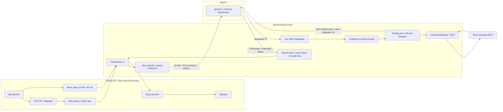

# GPT-Live with stock Xiaozhi firmware

GPT-Live is an optional speech-to-speech engine. Existing agents continue using
the ASR → LLM → TTS cascade until `live.enabled` is explicitly enabled.



## Enable

Add this to the mounted `data/.config.yaml`. This block is also retained when
the rest of the configuration comes from manager-api; no manager DB migration
is required for this first opt-in implementation.

```yaml
live:
  enabled: true
  device_ids: ["AA:BB:CC:DD:EE:FF"]
  api_key_env: OPENAI_API_KEY
  voice: marin
  # Optional extra instructions, appended to the engine's delegation prompt.
  instructions: "Use Russian throughout this conversation."
```

Set `OPENAI_API_KEY` in the server environment. Alternatively, `live.api_key`
can be set in that private file. When neither is present, the selected backend
LLM's `api_key` is used; that key must have access to OpenAI GPT-Live.
An empty `device_ids` list enables Live for all devices. For a gradual rollout,
use explicit device IDs. Revert `enabled` to `false` and restart to restore the cascade.

The existing `selected_module.LLM`, memory provider and MCP configuration are
the delegation backend. They do not synthesize audio in Live mode. An optional
`live.allowed_tools` list restricts delegation to those exact registered names;
when omitted the existing tool catalog is used, and an explicit empty list
disables tools. The voice prompt can be customized with `live.instructions`.

## Runtime behavior

- Firmware wake detection stays local. Cached wake audio sent before
  `listen.detect` is ignored. The server starts a cloud session after activation
  and requests a brief acknowledgement in the configured language.
- WebSocket v1 with mono Opus at 16 kHz and 60-ms frames is required. Both cloud
  directions use PCM16LE at 16 kHz, so this path needs no resampler. MQTT/UDP,
  WebSocket v2/v3, external ASR/VAD and voiceprint are not supported by this engine.
- The cloud microphone timeline is paced in 20-ms frames, with silence during
  gaps, paused capture and playback. Audio waits for `session.started`.
- Primary output has no audio-done event. A bounded speech gate produces the
  existing `tts.start`/`tts.stop` controls; captions group observed transcript
  deltas using timestamp gaps. Caption grouping is a heuristic.
- This implementation uses stock firmware's half-duplex behavior. Speech
  capture is paused while the column plays. Prompt instructions discourage
  backchannels; they do not guarantee full duplex or acoustic echo cancellation.
- Abort closes the old cloud generation. Late audio and captions cannot reach
  the device. Pending backend work is cancelled before further tool dispatch;
  an already dispatched call can remain unknown and is not retried automatically.
  A new activation starts a new session; closed usage is cumulative.
- Farewells delegate to the existing exit tool. Closing waits for later playback,
  with a bounded fallback when Live merges the preamble and farewell. A new user
  turn cancels the pending exit.
- Startup capture is bounded at six seconds by default. It fails explicitly on
  overflow. Output buffering is bounded at three seconds. `idle_timeout` defaults
  to 90 seconds; buffers and timing can be configured through the Live block.
  Only recognized user transcripts and output speech refresh this timer; ambient
  microphone energy does not keep a paid cloud session open.

## Memory and tools

Client delegation carries an ID, not the user's text. The adapter uses observed
transcripts and briefly waits for trailing deltas. It reuses the existing
`Dialogue`, text LLM stream and `UnifiedToolHandler`, including server and device MCP.

Before backend reasoning or actions, the configured memory lookup is awaited.
PowerMem's checked lookup distinguishes successful empty results from provider
failure; failure stops backend actions. The old cascade's failure policy is unchanged.

Live itself chooses whether to delegate and can produce autonomous speech.
Consequently, this mode **does not guarantee memory has been queried before
every voice reply**. A mandatory context-before-any-speech policy needs a
separate turn gate, not only a prompt telling Live to delegate.

Tool results and provider exceptions are bounded. For Live, server MCP calls
disable automatic reconnect-and-retry, and `isError` is treated as a failure.
An uncertain transport result or timeout is recorded as unknown; an equivalent
action is not automatically retried. Voice interruption cannot undo an action
already delivered to Home Assistant. Backend results are not recorded as heard
speech; observed output transcripts populate conversation history.

## Verify

Offline tests use fake cloud sockets and tools, without real credentials:

```sh
printf '{}\n' > /tmp/xiaozhi-offline-config.yaml
PYTEST_CONFIG_FILE=/tmp/xiaozhi-offline-config.yaml RUN_LIVE_API_TESTS=0 \
  pytest tests/test_live_voice.py tests/test_live_runtime.py tests/test_live_delegation.py -q
```

The tests cover session readiness, PCM/Opus boundaries, playback controls,
bounded input, invalid output, opt-in selection, transport rejection, abort and
late replies, disconnect cleanup, memory ordering, split tool arguments, failed
tools and uncertain actions. CI runs this suite on Python 3.10.

Physical wake detection, microphone capture, speaker playback, Wi-Fi recovery
and button interruption require the actual device. An audio file or virtual
Xiaozhi client confirms the server path, not those physical results.

Protocol sources: [primary WebSocket](https://developers.openai.com/api/reference/resources/live/primary-websocket),
[audio timeline](https://developers.openai.com/api/docs/guides/voice-websockets),
[client delegation](https://developers.openai.com/api/docs/guides/live-delegation),
[context delivery](https://developers.openai.com/api/docs/guides/live-conversations).
